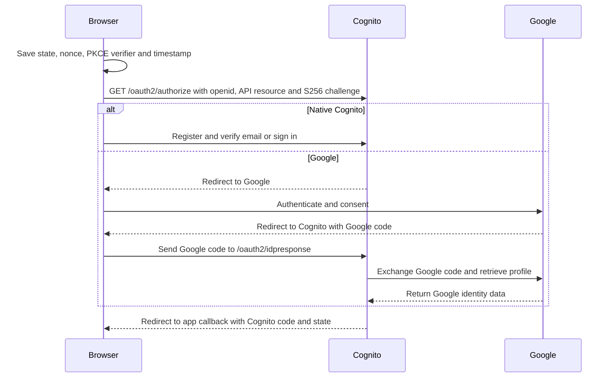
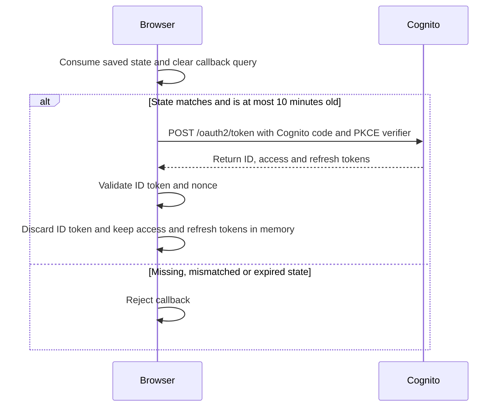
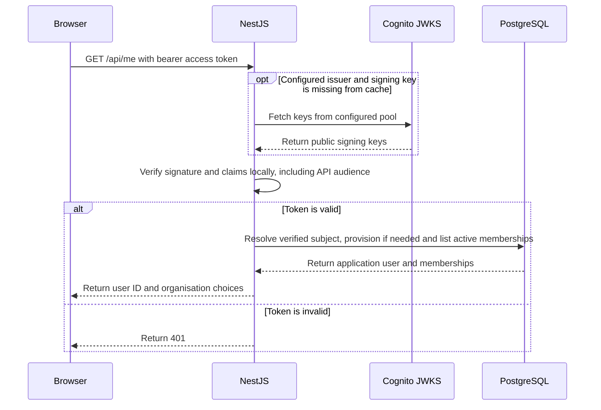
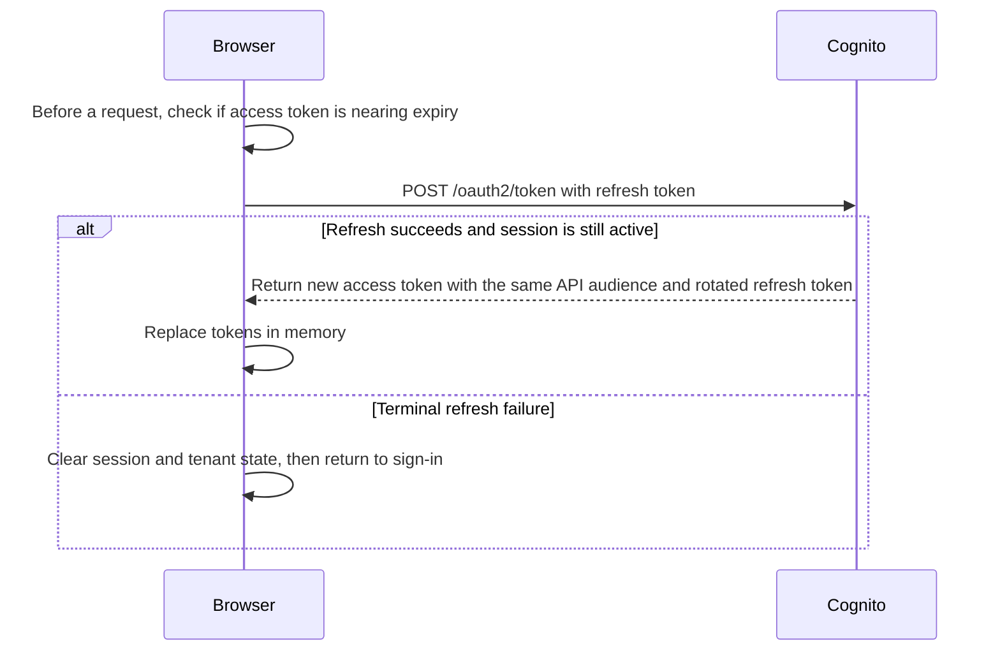
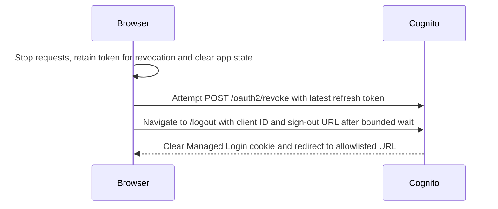
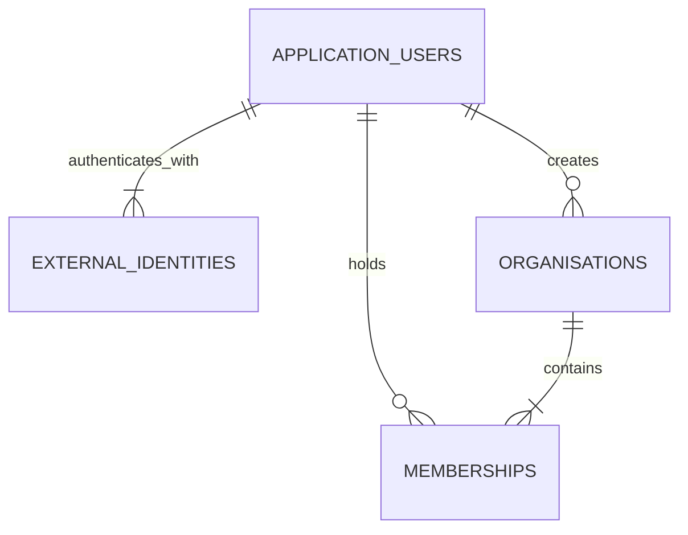
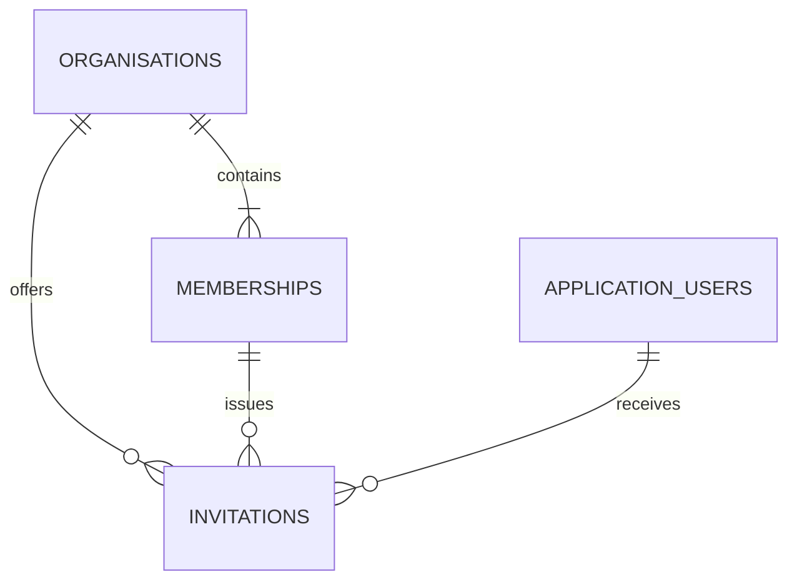
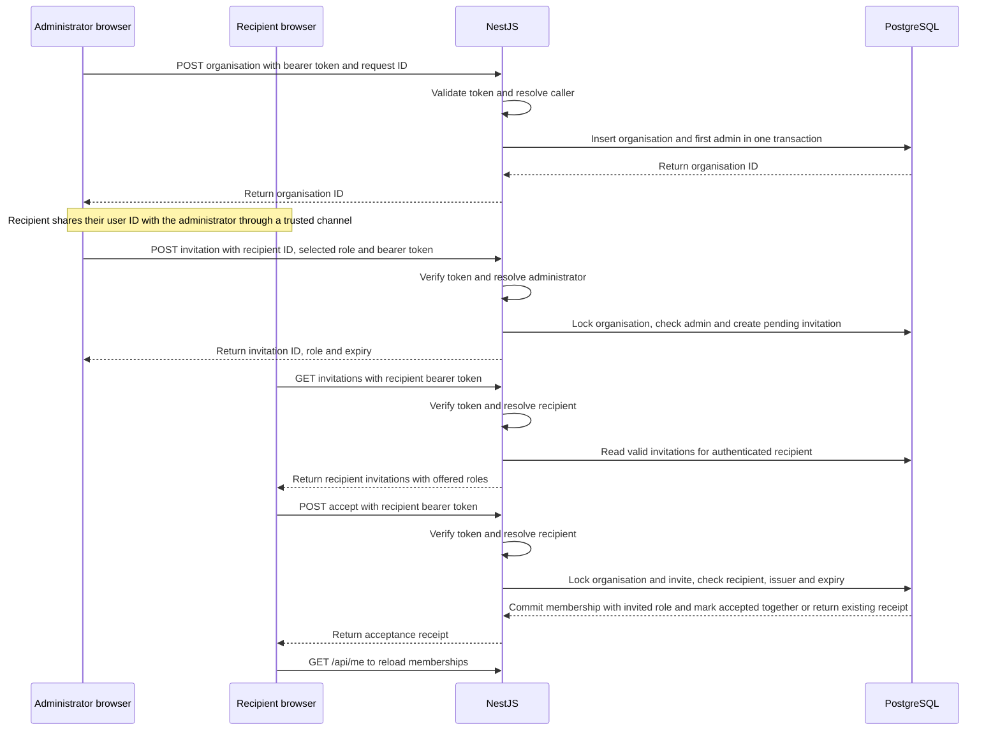
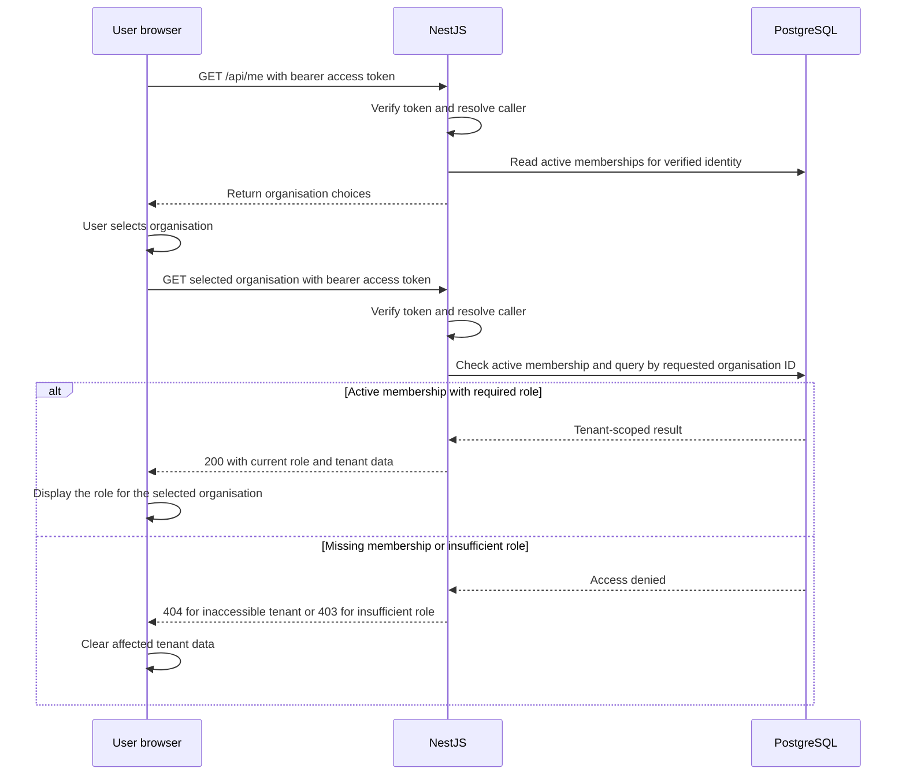

# Identity architecture

**Status** · Proposed for developer review in [Issue #12](https://github.com/MingxuanHu/ai-sales-operations/issues/12).

This design specifies the development Cognito configuration for #13, the PostgreSQL schema and NestJS contract for #14, and the React session and onboarding flows for #15. It follows the [identity ADR](../decisions/0004-identity.md) and [security guidance](../engineering/security.md). Prisma, application code and AWS provisioning belong to those implementation issues.

## Identity and federation

Each environment has its own database and trusts one configured Cognito User Pool issuer and public app client. The access token’s `sub` (subject) claim is the unique identifier Cognito assigns to the authenticated user within its user pool. NestJS verifies the token issuer against configuration, then uses the verified `sub` as the login key in that environment. [AWS Cognito access token claims](https://docs.aws.amazon.com/cognito/latest/developerguide/amazon-cognito-user-pools-using-the-access-token.html)

A valid new subject creates a user and identity in one transaction, with no memberships. Concurrent first requests converge on the unique subject. Roll back the losing insert transaction and resolve the winning identity. Replacing the pool requires migrating identity mappings before switching the configured issuer. Supporting multiple issuers in one database would require a schema change.

Each distinct Cognito subject provisions a separate application account in M2. Leave Cognito provider linking disabled in the application and infrastructure workflow. An administrator can invite a second sign-in identity explicitly as a separate member. Account linking or recovery across methods requires a future flow that verifies control of both identities and handles existing memberships. Email, provider usernames and provider profile claims never resolve or merge application users or grant membership. A renamed email or an absent verified-email claim therefore has no effect on existing access.

### Provider decisions

| Method | M2 decision | Configuration, access and review |
| --- | --- | --- |
| Native Cognito | Include for self-registration and password sign-in | Configure username-only sign-in and require and automatically verify email for native signup. Keep email as a profile attribute without enabling the email alias. Verify the duplicate-email behaviour with native and federated test users in #13 before relying on it. [Cognito sign-in attributes](https://docs.aws.amazon.com/cognito/latest/developerguide/user-pool-settings-attributes.html) |
| Google | Include via the built-in provider | Register a Google web OAuth client with the Cognito `/oauth2/idpresponse` redirect. Request basic identity scopes `openid email profile`. Map Google `email` and `email_verified` to the corresponding Cognito attributes. Test with synthetic identities. Public branding and any broader scope review belong to the public rollout. [AWS Google setup](https://docs.aws.amazon.com/cognito/latest/developerguide/cognito-user-pools-social-idp-google.html), [Google OAuth app states](https://developers.google.com/identity/protocols/oauth2/production-readiness/overview) |
| Facebook | Defer | Google covers federated sign-in for the demo. Facebook requires a separate Meta app and app-role testers in Development mode. Public access also requires Meta's applicable Business Verification and Advanced Access steps. [AWS Facebook setup and review requirements](https://docs.aws.amazon.com/cognito/latest/developerguide/cognito-user-pools-social-idp-facebook.html) |
| Personal Microsoft accounts, including Outlook.com | Defer | Microsoft supports personal-only app registration and the `consumers` authority. A separate spike would have to demonstrate fixed issuer validation for consumer tokens, client-secret authentication, scopes and UserInfo compatibility in Cognito. Registration and secret rotation add setup, and generic OIDC has a separate Cognito billing allowance. [Microsoft supported accounts](https://learn.microsoft.com/en-us/entra/identity-platform/supported-accounts-validation), [Microsoft issuer behaviour](https://learn.microsoft.com/en-us/entra/identity-platform/access-tokens), [Cognito OIDC requirements](https://docs.aws.amazon.com/cognito/latest/developerguide/cognito-user-pools-oidc-idp.html) |
| Microsoft work or school accounts | Defer separately | Multitenant Microsoft discovery uses a tenant-dependent issuer and access can depend on the organisation's consent policy. A future fixed-tenant integration could be evaluated separately. This adds issuer, consent and tenant administration work beyond the M2 social sign-in paths. [Microsoft app registration](https://learn.microsoft.com/en-us/entra/identity-platform/application-model), [Microsoft issuer behaviour](https://learn.microsoft.com/en-us/entra/identity-platform/access-tokens) |
| LinkedIn | Defer | LinkedIn offers a self-service OIDC sign-in product requested through the Developer Portal with `openid profile email`. Before adoption, verify LinkedIn discovery, issuer, `client_secret_post` and UserInfo behaviour against Cognito's OIDC requirements. LinkedIn documents that email claims can be absent. No provider fee is assumed in the M2 budget because this integration is deferred. [LinkedIn OIDC](https://learn.microsoft.com/en-us/linkedin/consumer/integrations/self-serve/sign-in-with-linkedin-v2), [LinkedIn product access](https://learn.microsoft.com/en-us/linkedin/shared/authentication/getting-access), [Cognito OIDC requirements](https://docs.aws.amazon.com/cognito/latest/developerguide/cognito-user-pools-oidc-idp.html) |

The demo supports native Cognito sign-in and Google as its sole federated provider. Use Cognito Essentials for Managed Login and refresh rotation. AWS lists a monthly free allowance of 10,000 direct or social active users for Essentials and a separate 50 for SAML or generic OIDC, subject to account or AWS organisation limits and regional exceptions. #13 checks current pricing for the chosen region and any email delivery and secret storage charges before provisioning. Provider client secrets stay in protected configuration. [AWS Cognito pricing](https://aws.amazon.com/cognito/pricing/)

## Browser session and API authentication

The static host serves the React bundle. The user’s browser runs it, handles the OAuth callback and token exchange, and sends protected API requests. NestJS verifies tokens and authorises requests.

### Sign-in and provider redirects

The browser app uses a public app client with Authorization Code + PKCE (`S256`). Register the exact development callback and sign-out URLs `http://localhost:5173/auth/callback` and `http://localhost:5173/`. Use HTTPS for deployed URLs. Request `openid` and pass the API base URL as the `resource` parameter, using `http://localhost:5173/api` for the local Vite proxy. Cognito puts that URL in the access token’s `aud` claim and carries it forward on refresh. Configure the browser and NestJS with the same API resource URL per environment. Upstream providers have separate scope settings. [Cognito resource binding](https://docs.aws.amazon.com/cognito/latest/developerguide/cognito-user-pools-define-resource-servers.html#cognito-user-pools-define-resource-servers-resource-binding)

Store the random state, nonce, PKCE verifier and timestamp in per-tab `sessionStorage` only for the redirect.

- **`state`** is a random value Cognito echoes in the callback. The browser compares it with the saved value to match the callback to the sign-in it started and help prevent cross-site request forgery.
- **`nonce`** is a separate random value Cognito puts in the signed ID token. The browser compares it with the saved value to confirm the token belongs to this sign-in attempt and help prevent replay.
- **PKCE verifier** is a random secret generated for the sign-in attempt. The browser sends its SHA-256-derived challenge in the authorisation request and the original verifier when exchanging the code. Cognito checks that they match, so an intercepted code alone cannot be redeemed.

[AWS Security Blog walkthrough of OAuth 2.0 in Cognito](https://aws.amazon.com/blogs/security/how-to-use-oauth-2-0-in-amazon-cognito-learn-about-the-different-oauth-2-0-grants/)

### Callback and token storage

Consume the entry once, reject mismatches and entries older than 10 minutes, and remove the callback query from browser history. Verify the returned ID token's signature, issuer, audience, expiry, token use and nonce using the configured Cognito keys and an OIDC client that supports these validation checks. [OpenID Connect ID token validation](https://openid.net/specs/openid-connect-core-1_0.html#IDTokenValidation)

Keep access and refresh tokens in browser app memory. Discard the ID token after callback validation. Reloading or opening a new tab starts a new authorisation flow when the user signs in. The existing Cognito session may complete that flow without another password prompt. Keep protected responses out of browser and proxy caches. Redact token headers, OAuth codes and callback query strings from logs and telemetry.

### Protected API requests

NestJS accepts only a bearer access token and verifies it locally on each protected request. Reuse a verifier per API process and cache Cognito’s public signing keys (JWKS) by key ID (`kid`). Fetch keys on a cold cache or when a token from the configured issuer has an unknown key ID. Share any in-flight fetch across concurrent requests. Apply a per-issuer cooldown to refreshes triggered by unknown keys so repeated requests cannot force a network call each time. Fail closed if no trusted key can verify the `RS256` signature. A cache hit requires no request to Cognito. [AWS guidance on verifying JWTs and caching signing keys](https://docs.aws.amazon.com/cognito/latest/developerguide/amazon-cognito-user-pools-using-tokens-verifying-a-jwt.html)

Verify exact `iss`, `token_use=access`, configured `client_id`, API resource URL in `aud`, expiry, `nbf` if present, a nonempty `sub`, and the `openid` scope. Reject missing or mismatched audiences. The API audience limits where the token can be used, while `client_id` identifies the browser client that obtained it. Tenant-scoped requests use an indexed PostgreSQL lookup for the current membership and role. M2 reads these from the database so removals and role changes take effect on the next request, even with an existing access token. [Cognito access token claims](https://docs.aws.amazon.com/cognito/latest/developerguide/amazon-cognito-user-pools-using-the-access-token.html)

### Token refresh

Configure 10-minute access and ID tokens, an 8-hour refresh token, refresh rotation and a short rotation grace period of 5 seconds. Serialize refresh requests per tab and replace the old refresh token on success. Refresh near access-token expiry when the app needs a request. On a terminal refresh failure, clear auth and tenant state and return to sign-in. Ignore any in-flight refresh result after logout. The 10-minute access-token lifetime limits how long a copied token can be used. The Cognito Managed Login cookie has a separate one-hour lifetime. [Token endpoint](https://docs.aws.amazon.com/cognito/latest/developerguide/token-endpoint.html), [Refresh rotation](https://docs.aws.amazon.com/cognito/latest/developerguide/amazon-cognito-user-pools-using-the-refresh-token.html), [Access token behaviour](https://docs.aws.amazon.com/cognito/latest/developerguide/amazon-cognito-user-pools-using-the-access-token.html)

### Sign-out

On sign-out, stop protected requests, clear session and tenant state and cancel outstanding auth and tenant work. Attempt to revoke the latest refresh token at `/oauth2/revoke` with a bounded wait, then navigate to Cognito `/logout` with the client ID and allowlisted sign-out URL even if revocation fails. The upstream Google session can remain active. If revocation fails or an in-flight refresh rotates the token before the browser can revoke it, the browser still signs out and discards any late result. A previously copied access token can still pass local JWT verification until expiry. Membership revocation takes effect independently through the database on the next request. [Revocation behaviour](https://docs.aws.amazon.com/cognito/latest/developerguide/token-revocation.html), [Managed Login sign-out](https://docs.aws.amazon.com/cognito/latest/developerguide/logout-endpoint.html)

## PostgreSQL schema

The following is the logical schema for #14. UUID primary keys are generated by the service or database. Timestamps are `timestamptz`. Columns are required unless marked nullable. Creation timestamps default to database time. Foreign keys restrict deletion. Retain invitation records and soft-delete memberships. The invitation’s composite foreign key continues to identify the issuing membership after removal. User disablement, organisation deletion and hard deletion require separately designed lifecycles.

### Users and memberships

### Invitations

### Tables and constraints

| Table | Columns | Keys, checks and indexes |
| --- | --- | --- |
| `application_users` | `id uuid`, `created_at timestamptz` | PK `id`. Share this opaque UUID with a known administrator for onboarding. |
| `external_identities` | `id uuid`, `user_id uuid`, `subject text`, `created_at timestamptz` | PK `id`. FK `user_id → application_users.id`. Unique `subject`. Index `user_id`. Subject is immutable. |
| `organisations` | `id uuid`, `name varchar(120)`, `created_by_user_id uuid`, `creation_request_id uuid`, `created_at timestamptz` | PK `id`. FK creator → application user. Unique `(created_by_user_id, creation_request_id)` for idempotent creation. Trim name and require 1–120 characters. Name changes are outside M2. |
| `memberships` | `organisation_id uuid`, `user_id uuid`, `role membership_role`, `status membership_status`, `created_at timestamptz`, `updated_at timestamptz` | PK `(organisation_id, user_id)`. FKs to organisation and application user. Index `(user_id, status, organisation_id)` for selection and `(organisation_id, status, role)` for administrator checks. Update `updated_at` on every change. |
| `invitations` | `id uuid`, `organisation_id uuid`, `issued_by_user_id uuid`, `recipient_user_id uuid`, `role membership_role`, `status invitation_status`, `created_at timestamptz`, `expires_at timestamptz`, `resolved_at timestamptz` nullable | PK `id`. FKs to organisation and recipient user. Composite FK `(organisation_id, issued_by_user_id) → memberships`. Index `(recipient_user_id, status, expires_at)` for the inbox and `(organisation_id, issued_by_user_id, status)` for invalidation. Partial unique index on `(organisation_id, recipient_user_id)` for `pending`. The invitation role is required and immutable. Check `expires_at > created_at` and require `resolved_at` exactly when status is terminal. |

Use PostgreSQL enums or equivalent constrained values for:

- `membership_role` · `admin`, `salesperson`, `manager`. Each membership has exactly one role. All three roles can enter the organisation. The inviting administrator selects the role.
- `membership_status` · `active`, `removed`. Removal sets the status to `removed` and retains the row. Only active memberships grant access. Accepting a fresh invitation reactivates the row with the new invitation’s role.
- `invitation_status` · `pending`, `accepted`, `revoked`, `expired`. Terminal states never transition. Pending records become ineffective at `expires_at` even before a write marks them expired.

## Onboarding and tenant permissions

### Create an organisation

Any authenticated application user may create a synthetic organisation. In one transaction insert the organisation and the caller's active `admin` membership. React generates one request UUID per creation intent. The same caller and request UUID with the same name returns the original organisation ID, even if the caller's membership has since changed. A different name with that key returns `409`. The retry path performs no membership write.

### Issue an invitation

The recipient signs in, copies their user ID from their own session and shares it through a trusted channel. An active administrator enters that ID and selects `admin`, `salesperson` or `manager`. The service checks the recipient exists, has no active membership in that organisation, and stores a seven-day pending invitation bound to the recipient and organisation. Show the offered role with each pending invitation in the recipient's authenticated inbox. There is no email directory, email delivery or bearer invitation link. A request for the same recipient and role returns the existing valid pending invitation. A request with a different role returns `409`. Revoke the pending invitation before issuing one with a different role. When issuing a new invite, mark any elapsed pending invite expired before inserting its replacement.

### Accept or revoke an invitation

Lock the organisation row, then re-read and lock the invitation. A wrong recipient receives `404` with no mutation. After checking the recipient, return an already accepted invitation as an idempotent success without touching membership. For a fresh acceptance, require pending status, a future expiry using PostgreSQL’s `clock_timestamp()` after acquiring the lock, and an active administrator as issuer. Insert or reactivate the recipient’s membership using the role stored on the invitation and mark the invite accepted in the same transaction. If an active membership already exists, resolve the invitation without changing its role. An active administrator may revoke a still-valid pending invite. For acceptance or revocation of an elapsed pending invite, return the expired result and optionally persist the terminal state. Issuance always resolves elapsed pending invites before inserting a replacement. Revoked or expired invites return `409` on acceptance. A recorded acceptance is a receipt. The client reloads current memberships separately.

### Change roles or remove membership

An active administrator can assign any defined role to an active member or remove their membership, including changing their own role or membership. Soft-delete removals by setting `status = removed`. Preserve at least one active administrator. An administrator demotion or removal also revokes that issuer's pending invitations in the same transaction. Removing a member revokes pending invites to that user for the same organisation. An administrator can send a fresh invitation later. Never use an accepted invite as a path to reinstate access.

### Organisation selection and tenant access

React loads active memberships from `GET /api/me`. Show onboarding when empty, enter the sole organisation automatically, and offer a picker for multiple memberships. The selected organisation ID lives in the app route. Before rendering tenant data, confirm access via the API. On switch or denial, cancel old requests and clear the displayed tenant data. Key cached data by user and tenant and discard late responses for a previous selection. NestJS treats the path ID as input and checks it against current membership. Tenant queries always include the same organisation ID, including lookups by nested resource ID.

### Transaction boundaries

Use PostgreSQL Read Committed for tenant mutations. Acquire the same organisation row lock first using `SELECT … FOR UPDATE`. In subsequent statements, re-read the acting membership and target state so they reflect changes committed while waiting for the lock. This serializes last-admin checks and handles concurrent demotion, removal, acceptance and invitation replacement. Any later tenant mutation using this policy checks current access and performs its write in that same transaction. Reads check current membership and tenant scope in the same database statement or a single read-only snapshot. A read already in progress can complete under its existing snapshot. [PostgreSQL transaction isolation](https://www.postgresql.org/docs/current/transaction-iso.html#XACT-READ-COMMITTED)

## Organisation roles and resource permissions

A user can be a `salesperson` in one organisation and a `manager` in another. NestJS reads the active membership for the requested organisation on every protected request. The browser updates the displayed role from the selected organisation's API response and discards stale responses after a switch. The access token stays the same and carries no application role.

| Resource and action | Allowed role | Milestone |
| --- | --- | --- |
| Organisation overview · view | Any active membership | M2 |
| Invitations · issue or revoke | `admin` | M2 |
| Memberships · assign roles or remove access | `admin` | M2 |
| Orders · create | `salesperson` | M6 |
| Discount approvals · approve | `manager` | M6 |

Permissions are explicit per action. Roles grant no inherited permissions. An administrator can manage staff, while creating orders and approving discounts require the respective business role in that organisation. M2 stores and assigns all three roles and enforces the M2 actions. M6 implements the proposed order actions and defines the remaining order permissions and state transitions.

For each resource action, NestJS checks active membership and the required permission, then scopes the resource and related records to that same organisation. Order creation validates that the customer and products belong to the organisation. Discount approval loads the order within that organisation and requires it to be pending discount approval. Check the current role and applicable resource state in the same transaction as the write. An active member without the action permission receives `403`. A resource outside the tenant scope receives `404` when looked up by an authorised caller.

## Protected API contract

All routes below use the bearer token, return JSON except for `204`, and send `Cache-Control: no-store`. The organisation ID in a tenant path is the only tenant selector. Reject malformed UUIDs and invalid payloads with `400`. Return `401` for missing or invalid authentication, `403` for an active member with insufficient role, and `404` for an unknown or inaccessible organisation, cross-tenant resource or invitation belonging to another recipient. Use `409` for lifecycle conflicts such as removing the last administrator.

| Request | Access and successful result |
| --- | --- |
| `GET /api/me` | Signed in. `200 { userId, memberships: [{ organisationId, name, role }] }`. The list includes active memberships only. |
| `POST /api/organisations` | Signed in. Input `{ name, requestId }`. `201 { organisationId }` or `200` with the same ID on retry. |
| `GET /api/organisations/{organisationId}` | Active member. `200 { organisationId, name, role }`, using the caller's current role. |
| `POST /api/organisations/{organisationId}/invitations` | Active admin. Input `{ recipientUserId, role }` with a required membership role. `201 { invitationId, role, expiresAt }` or `200` for an existing valid pending invite with the same role. Unknown recipient gives `404`. An existing active membership or a valid pending invite with a different role gives `409`. |
| `GET /api/invitations` | Signed in. `200 { invitations: [{ invitationId, organisationId, name, role, expiresAt }] }` for the caller's pending unexpired invites. The organisation name and offered role are disclosed only to the intended recipient. |
| `POST /api/invitations/{invitationId}/accept` | Intended recipient. `200 { invitationId, organisationId, status: "accepted" }` on acceptance or a retry. |
| `DELETE /api/organisations/{organisationId}/invitations/{invitationId}` | Active admin in that organisation. `204` for revocation or repeat revocation. Return `409` for accepted or expired invitations. |
| `PATCH /api/organisations/{organisationId}/memberships/{userId}` | Active admin. Input `{ role }` with one of the three membership roles. `200 { userId, role, status }` for an active target. An absent or removed target gives `404`. |
| `DELETE /api/organisations/{organisationId}/memberships/{userId}` | Active admin. `204` for soft deletion or an already removed target. An absent target gives `404`. |

## Review walkthrough

| Scenario | Expected result |
| --- | --- |
| First verified sign-in and organisation creation | `GET /api/me` initially lists zero memberships. A failed first-admin insert rolls back the organisation. Concurrent retries with the same request ID converge on one organisation and admin membership. |
| Native and federated logins return the same email | Each distinct Cognito subject has its own application user. The second identity starts with zero memberships and must receive its own invitation. Use native Cognito and Google for the live smoke test. |
| Invitation accepted, replayed, or presented by another user | The intended recipient gets one active membership with the offered role and one acceptance receipt. Retrying issuance with a different role returns `409`. A fresh invitation can reactivate a removed membership with the newly offered role. An unrelated signed-in user receives `404`. An expired or revoked invite gives `409`. Replaying acceptance after membership removal returns the receipt and leaves the membership removed. |
| Two memberships and a tenant switch | The same user is a salesperson in organisation A and a manager in organisation B. Switching changes the displayed role and the API permissions without signing in again. A response from the prior tenant arriving after the switch is discarded. |
| Order permissions in M6 | The user can create orders in A and approve a pending discount in B. Creating in B or approving in A returns `403`. Trying to approve an order from A through the authorised route for B returns `404`. |
| Membership removed while access token remains valid | The next protected request to that organisation returns `404`; the same token can still access another active membership. The removed administrator’s membership row and invitation records are retained. Pending invitations they issued are revoked. |
| Concurrent attempts to remove or demote the last administrators | The organisation lock serializes the changes. A change that would leave zero active administrators returns `409`. |
| Cross-tenant identifiers and member-only access | A valid user requesting a foreign organisation or foreign nested record receives `404`. An active member trying to issue an invitation in their own organisation receives `403`. |
| Token and logout boundaries | Wrong issuer, client, audience, token use, signature or expiry returns `401`. Refresh preserves the API audience and rotates the refresh token. A terminal refresh failure clears the app session. Logout clears app and Cognito session state, with the documented remaining access-token lifetime and upstream session behaviour. |

The browser and API flows follow the OAuth security guidance for exact redirect matching, S256 PKCE, audience restriction and refresh-token rotation. [OAuth 2.0 Security Best Current Practice](https://www.rfc-editor.org/rfc/rfc9700.html#section-2)

Run `node scripts/check-docs.mjs` for this issue. The database, browser and provider checks above are expected outcomes for the review walkthrough and later implementation. #13 verifies development provider configuration, #14 covers database-backed and API behaviour, and #15 verifies the protected shell and live sign-in with synthetic accounts.
