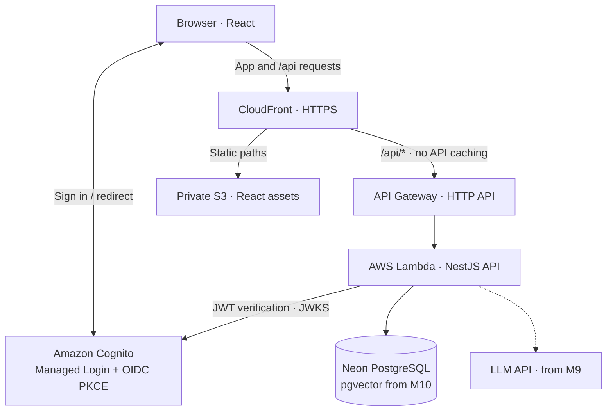
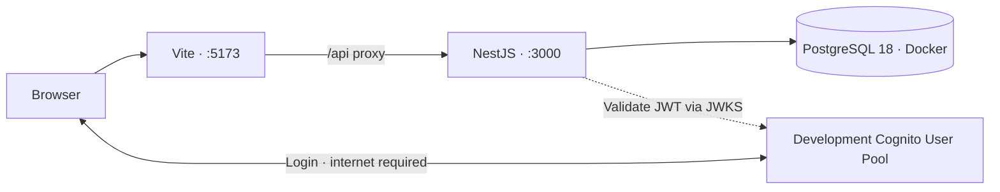

# System architecture

The **same NestJS business modules** serve local HTTP requests and AWS Lambda requests. Only the entrypoint/adapter changes.

## Public demo (target from M3)

Cognito authenticates users. NestJS resolves organisation membership and enforces tenant-scoped authorisation on every protected request. The LLM cannot bypass business services or approve orders.

## Local development (target from M2)

M1 runs the web/API health shell and local database **without** Cognito. Real login added in M2 uses a separate development User Pool; automated tests can mock token verification without a live AWS dependency.

## Design boundaries

- Modular monolith, PostgreSQL transactional data, controlled metrics/query APIs.
- React never receives database or LLM credentials.
- Public demo uses synthetic data and one low-cost cloud environment; no always-on staging stack.
- From M3, local HTTP entrypoint and Lambda adapter share controllers, guards and services.
